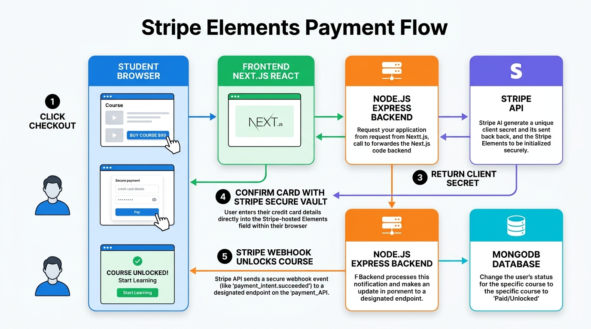

# Stripe Elements Payment Flow (Embedded Form Integration)

This document provides a **complete visual guide** explaining how the Stripe Elements payment cycle works between the **Student**, **Frontend**, **Node.js Backend**, **Stripe**, and **MongoDB**.

---

## 🖼️ Visual Architecture Diagram

---

## 📊 Interactive Step-by-Step Flowchart

```mermaid
flowchart TD
    %% Styling classes
    classDef student fill:#2563EB,stroke:#1D4ED8,stroke-width:2px,color:#fff;
    classDef frontend fill:#10B981,stroke:#059669,stroke-width:2px,color:#fff;
    classDef backend fill:#F97316,stroke:#EA580C,stroke-width:2px,color:#fff;
    classDef stripe fill:#8B5CF6,stroke:#7C3AED,stroke-width:2px,color:#fff;
    classDef db fill:#06B6D4,stroke:#0891B2,stroke-width:2px,color:#fff;

    subgraph Step1["Step 1: Start Purchase"]
        A["👤 Student clicks 'Buy Course ($49.99)'"]:::student
        B["💻 Frontend sends POST /create-payment-intent with courseId"]:::frontend
        A --> B
    end

    subgraph Step2["Step 2: Prepare Payment"]
        C["⚙️ Node.js Backend fetches real price from MongoDB ($49.99)"]:::backend
        D["💳 Stripe API creates PaymentIntent and returns client_secret"]:::stripe
        B --> C
        C --> D
    end

    subgraph Step3["Step 3: Receive Secret Token"]
        E["⚙️ Backend sends { clientSecret } back to Frontend"]:::backend
        D --> E
        E --> F["💻 Frontend initializes Stripe Elements input form"]:::frontend
    end

    subgraph Step4["Step 4: Secure Card Payment"]
        G["👤 Student enters Card Number, Expiry, CVC"]:::student
        G2["👤 Student clicks 'Pay $49.99' (2nd click, inside the card form)"]:::student
        H["🔒 Frontend sends card directly to Stripe Vault<br/>(Backend NEVER touches card numbers!)"]:::stripe
        F --> G
        G --> G2
        G2 --> H
    end

    subgraph Step5["Step 5: Fulfillment & Webhook"]
        I["💳 Stripe charges card and sends Webhook event: payment_intent.succeeded"]:::stripe
        J["⚙️ Node.js Backend receives Webhook and unlocks course"]:::backend
        K[("🗄️ MongoDB saves Enrollment: Student + Course")]:::db
        L["🎉 Student UI updates to 'Course Unlocked! Start Learning'"]:::student

        H --> I
        I --> J
        J --> K
        K --> L
    end
```

---

## 🔍 The 5 Simple Steps Explained

### 1️⃣ Step 1: Student Clicks Buy
- The student visits the course page and clicks **"Buy Course ($49.99)"**.
- The Frontend calls the Backend:  
  `POST /api/v1/payment/create-payment-intent` with `{ courseId: "123" }`.

---

### 2️⃣ Step 2: Backend Asks Stripe for a Secret Ticket
- The Backend looks up the course in MongoDB to get the verified price ($49.99).
- The Backend tells Stripe:  
  `stripe.paymentIntents.create({ amount: 4999, currency: 'usd', metadata: { courseId, studentId } })`.
- Stripe generates a **`client_secret`** (a temporary token for this specific payment).

---

### 3️⃣ Step 3: Frontend Gets the `client_secret`
- The Backend sends `{ clientSecret }` back to the Frontend.
- The Frontend uses this `clientSecret` to show the **Stripe Elements** card box (the form you saw in the screenshot).

---

### 4️⃣ Step 4: Card Sent Directly to Stripe (100% Secure)
> ⚠️ **Important: there are TWO separate clicks in this whole flow, not one.**
> - **Click #1** = Step 1's "Buy Course" button → this only *starts* checkout, no money moves yet.
> - **Click #2** = a "Pay $49.99" button that appears *inside the card form* after the student fills Card Number, Expiry, CVC → this is the click that actually charges the card.

- The student types their **Card Number**, **Expiry Date**, and **CVC**.
- The student clicks **"Pay $49.99"** (the 2nd click), and the Frontend calls `stripe.confirmCardPayment(clientSecret, { card })`.
- ⚠️ **Notice**: The credit card details go **directly from the student's browser to Stripe's secure vault**. Your Node.js backend never sees or touches the card numbers!

---

### 5️⃣ Step 5: Stripe Webhook Unlocks the Course
- Once the payment succeeds, Stripe calls your Backend webhook:  
  `POST /api/v1/payment/webhook` with event `payment_intent.succeeded`.
- Your Backend reads `courseId` and `studentId` from the metadata.
- Your Backend creates an **Enrollment** in MongoDB and unlocks the course for the student.

---

## ☕ The Café Analogy (Easy to Remember)

| Concept | Café Comparison |
| :--- | :--- |
| **Course** | A cup of coffee on the menu |
| **`create-payment-intent`** | The cashier rings up the register and prints an order ticket |
| **`client_secret`** | The order number on your paper ticket |
| **Stripe Elements Form** | The chip-and-PIN card terminal machine at the counter |
| **Webhook** | The bell that dings when the bank approves the card, telling the barista to pour the coffee |

---

## 📚 Official Stripe Docs (read these for real understanding)
- [Accept a payment (Elements Guide)](https://docs.stripe.com/payments/accept-a-payment?ui=elements) — the main guide, matches this flow step by step
- [How to create a PaymentIntent (API Reference)](https://docs.stripe.com/api/payment_intents/create) — official reference for `stripe.paymentIntents.create()` parameters and return values
- [The Payment Intents Lifecycle](https://docs.stripe.com/payments/payment-intents) — explains `client_secret`, status changes, and why PaymentIntents exist
- [Stripe Node.js & React Quickstart](https://docs.stripe.com/payments/quickstart) — full working code sample for both backend and frontend
- [Payment Element Integration Best Practices](https://docs.stripe.com/payments/payment-element/best-practices) — read after the basic flow makes sense

---

## 💼 Interview Tip
> **Question**: *"Why do we use Webhooks instead of just trusting the frontend response after payment?"*  
> **Answer**: *"Because the frontend is running on the client's device, which can lose connection, close the browser tab, or even be faked by a malicious user. The webhook is a secure, direct server-to-server confirmation from Stripe that guarantees the money was actually collected before unlocking content."*
